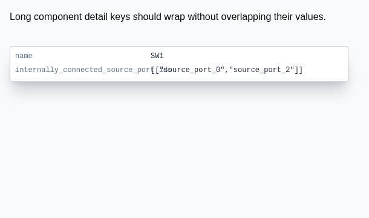

# Repro: internal Circuit JSON IDs shown in component details

## Steps

1. Run `bun install` and `bun start` from this repository.
2. Open the `example40-long-component-details-label` fixture in React Cosmos.
3. Inspect the `SW1` details popup at a width of 560px.

The switch includes `internally_connected_source_port_ids` in its Circuit JSON.
Previously, the details popup displayed this internal field and its source-port
IDs, which are not useful to people inspecting a component. The long field name
could also overlap the value column.

## Expected behavior

Only user-relevant component information, such as `name` and
`manufacturer_part_number`, is visible. Internal fields named `id`, ending in
`_id`, or ending in `_ids` are hidden from this popup, but they are still
available in the underlying Circuit JSON for circuit operations.

Long non-ID property labels may still wrap inside their own column.

## Screenshots

Before (original implementation exposes internal IDs):

After (the ID fields are hidden, while `SW1` and `TL3342` remain):

Both screenshots render the `SchematicComponentDetailsTooltip` React component.
The before image demonstrates the original ID exposure and overlap. The after image illustrates the companion fix in [PR #304](https://github.com/tscircuit/schematic-viewer/pull/304). This reproduction PR intentionally does not include the fix.

Regression test: `tests/schematic-component-details-long-label.test.tsx`.
