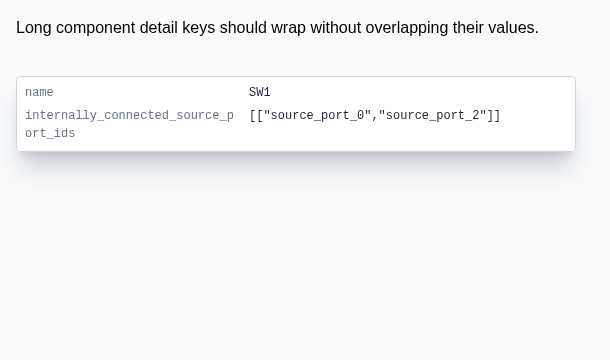

# Repro: long component-detail label overlaps its value

## Steps

1. Run `bun install` and `bun start` from this repository.
2. Open the `example40-long-component-details-label` fixture in React Cosmos.
3. Inspect the `SW1` details popup at a width of 560px.

The `internally_connected_source_port_ids` label is longer than the first grid
column. Without wrapping, it overlaps the array value displayed in the second
column. The field is valid Circuit JSON; this is a presentation bug.

## Expected behavior

Property names and values remain legible even when a property name exceeds its
column width. Long labels may wrap to a second line.

## Screenshots

Before (the original label wrapping behavior):

After (`overflow-wrap: anywhere` on the label):

The screenshots show the same `SchematicComponentDetailsTooltip` fixture. The
before image overrides only the new label wrapping property to reproduce the
original behavior; the after image uses the fixed component style.

Regression test: `tests/schematic-component-details-long-label.test.tsx`.
